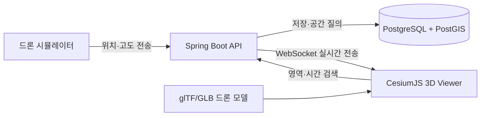

# GeoGuard 3D — 하루 포트폴리오 프로젝트 계획

- 작성일: 2026-10-02
- 목표 시간: 약 8~10시간
- 프로젝트 유형: 개인 포트폴리오용 3D Web GIS[^web-gis]
- 지원 직무: 헬리오센 GIS Application 개발자

## 현재 구현 상태

- [x] CesiumJS 관제 화면과 자체 제작 GLB 드론 모델
- [x] Spring Boot REST API, WebSocket, PostGIS 공간 질의
- [x] 위험구역·텔레메트리·이벤트 스키마와 합성 데이터
- [x] 10만 건 이상 생성기와 GiST 인덱스 비교 SQL
- [x] 실시간 드론 텔레메트리 시뮬레이터
- [x] 프런트엔드 프로덕션 빌드와 백엔드 단위 테스트
- [x] 실제 PostGIS 대상 핵심 통합 테스트 3개 통과
- [ ] Docker 기반 전체 서비스 실행 및 PostGIS 통합 테스트
- [x] 실제 환경에서 10만 건 적재 후 성능 수치 기록
- [ ] 최종 시연 스크린샷 또는 GIF 촬영

현재 작업 환경에는 Docker와 WSL이 없어 Docker Compose 전체 실행은 보류했다. 대신 portable PostgreSQL 16.15와 PostGIS 3.6.2에서 실제 통합 테스트 3개와 10만 건 적재·인덱스 전후 측정을 완료했다. 측정 결과는 `infra/db/benchmark/results/2026-10-02-postgis-results.md`에 기록했다.

## 1. 한 줄 목표

**드론의 위치·고도 데이터를 실시간으로 수집하고, 위험구역 진입 여부를 공간 분석하여 3D 지도에 표시하며, 저장된 비행 이력을 공간·시간 조건으로 검색하는 미니 관제 시스템을 만든다.**

프로젝트명은 **GeoGuard 3D**로 한다.

## 2. 이 프로젝트로 보여줄 역량

| 지원 자격 | 프로젝트에서 제시할 근거 |
|---|---|
| GIS 개발업무 경험 | 좌표계, GeoJSON[^geojson], 공간 연산, 지도 영역 검색, 3D 지도 시각화 |
| 3D 모델 데이터 처리 경험 | 드론 모델을 glTF/GLB[^gltf]로 변환·최적화하고 위치·고도·방향에 맞춰 배치 |
| 대용량 공간정보 수집·저장·검색 경험 | 실시간 위치 수집, PostGIS 저장, 10만 건 이상 테스트 데이터, 공간 인덱스 적용 및 성능 비교 |
| 백엔드 서비스 개발 경험 | REST API[^rest], WebSocket[^websocket], 요청 검증, 오류 처리, API 문서와 테스트 |

> 이 프로젝트는 관련 기술을 직접 구현했다는 증거가 될 수 있지만, 채용 공고의 **3년 이상 실무 경력**을 대체하지는 않는다. 이력서에는 반드시 `개인 프로젝트`로 표기한다.

## 3. 최종 결과물

화면 한 개에서 다음 동작을 시연할 수 있어야 한다.

1. 3D 지도에 위험구역과 드론 모델이 나타난다.
2. 드론이 이동하면서 위치·고도·방향이 1초 간격으로 갱신된다.
3. 위험구역에 접근하거나 진입하면 `SAFE → WARNING → DANGER`로 상태가 바뀐다.
4. 드론 위치가 PostGIS[^postgis]에 저장된다.
5. 시간 범위와 현재 지도 영역으로 과거 비행 경로를 검색할 수 있다.
6. 10만 건 이상의 위치 데이터에서 공간 인덱스 적용 전후 검색 시간을 비교한다.

## 4. 기술 스택

헬리오센의 공개 제품 구성과 채용요건에 등장한 기술을 중심으로 선택한다.

| 구분 | 선택 기술 | 선택 이유 |
|---|---|---|
| 프런트엔드 | TypeScript, Vite, CesiumJS[^cesium] | 웹 기반 3D GIS와 glTF·GeoJSON 시각화 |
| 백엔드 | Java, Spring Boot, Gradle | 공고의 Java 경험과 전자정부프레임워크·Gradle 요구에 인접한 구성 |
| 공간 데이터베이스 | PostgreSQL, PostGIS | 회사 공개 스택이며 공간 저장·검색과 인덱싱 지원 |
| 실시간 통신 | WebSocket | 드론 위치와 경고 상태를 양방향으로 갱신 |
| 3D 데이터 | glTF/GLB | 웹 전송에 적합한 3D 모델 포맷이며 회사 제품에서도 사용 |
| 실행 환경 | Docker Compose[^docker-compose] | PostGIS와 애플리케이션을 재현 가능한 방식으로 실행 |
| 문서·검증 | Swagger/OpenAPI[^openapi], JUnit | API 사용법과 핵심 동작을 검증 |

### 오늘 사용하지 않을 기술

GeoServer, GeoWebCache, RabbitMQ, Unity, Unreal, 실제 드론, 실제 MQTT 센서, 사용자 인증, 3D Tiles[^3d-tiles] 생성은 제외한다. 회사 기술과 관련은 있지만 하루 프로젝트의 핵심을 흐리고 설정 시간이 길기 때문이다. README의 `향후 확장`에만 기록한다.

## 5. 시스템 구성



권장 폴더 구조:

```text
gis-app/
├─ frontend/                # CesiumJS 화면
├─ backend/                 # Spring Boot API
├─ assets/
│  ├─ raw/                  # 변환 전 3D 모델
│  └─ processed/            # 변환·최적화한 GLB
├─ infra/
│  └─ db/init/              # PostGIS 스키마와 테스트 데이터
├─ docs/                    # 스크린샷과 성능 측정 결과
├─ compose.yaml
└─ README.md
```

## 6. 핵심 기능 범위

### A. 3D 지도와 모델 처리

- CesiumJS에서 지구 또는 평면 지형을 표시한다.
- 위험구역을 GeoJSON 폴리곤으로 표시한다.
- 드론 원본 모델을 GLB로 변환하고 축, 크기, 중심점을 보정한다.
- 위도·경도·고도를 3D 위치로 변환한다.
- 이전 위치와 현재 위치를 이용해 드론의 진행 방향을 계산한다.
- 최적화 전후 파일 크기를 README에 기록한다.

최소 증빙:

```text
원본 모델 형식/용량 → 변환 도구와 옵션 → 결과 GLB 용량 → Cesium 배치 방법
```

### B. 실시간 수집과 위험 판정

- 시뮬레이터가 1초마다 드론의 위치, 고도, 시각을 생성한다.
- 백엔드는 데이터를 검증한 뒤 PostGIS에 저장한다.
- WebSocket으로 최신 위치를 프런트엔드에 전달한다.
- 위험구역과의 거리 및 포함 여부에 따라 상태를 판정한다.

판정 규칙:

```text
SAFE    : 위험구역과 200m 초과 거리
WARNING : 위험구역 경계와 200m 이내이며 제한 고도와 겹침
DANGER  : 위험구역 내부이며 제한 고도와 겹침
```

수평 위치는 PostGIS 공간 연산으로 판정하고, 고도는 위험구역의 `min_altitude`와 `max_altitude` 범위로 판정한다.

### C. 공간정보 저장과 검색

핵심 테이블:

```text
telemetry
├─ id
├─ drone_id
├─ recorded_at
├─ position geometry(PointZ, 4326)
├─ altitude
└─ status

restricted_zone
├─ id
├─ name
├─ boundary geometry(Polygon, 4326)
├─ min_altitude
└─ max_altitude
```

필수 검색 조건:

- 드론 ID
- 시작·종료 시각
- Bounding Box[^bbox]
- 위험 상태
- 위험구역과의 거리

필수 인덱스:

- `position`과 `boundary`의 GiST 공간 인덱스[^gist]
- `drone_id, recorded_at` 복합 인덱스

### D. 백엔드 API

```text
POST /api/telemetry/batch
GET  /api/telemetry?droneId=&bbox=&from=&to=
GET  /api/drones/{id}/track?from=&to=
GET  /api/zones
GET  /api/events?status=DANGER
POST /api/routes/analyze
WS   /ws/telemetry
```

API 구현 시 포함할 것:

- 입력값 검증
- 일관된 오류 응답
- 조회 건수 제한 또는 페이지네이션[^pagination]
- Swagger/OpenAPI 문서
- 공간검색과 위험 판정에 대한 통합 테스트

## 7. 대용량 데이터 검증 방법

`대용량`이라는 표현은 건수와 측정 결과가 있을 때만 사용한다.

1. SQL 또는 테스트 데이터 생성기로 위치 데이터 **최소 100,000건**을 만든다.
2. 시간이 남으면 **1,000,000건**까지 확장한다.
3. 동일한 Bounding Box·시간 범위 쿼리를 인덱스 적용 전후 실행한다.
4. 실행 시간과 조회 건수를 표로 남긴다.
5. 가능하면 `EXPLAIN ANALYZE`[^explain] 결과를 `docs/`에 저장한다.

성능 기록 양식:

| 데이터 건수 | 검색 조건 | 인덱스 전 | 인덱스 후 | 개선율 |
|---:|---|---:|---:|---:|
| 실제 측정값 | bbox + 시간 범위 | 실제 ms | 실제 ms | 실제 % |

측정하지 않은 수치를 임의로 작성하지 않는다.

## 8. 오늘 작업 일정

| 시간 | 작업 | 완료 기준 |
|---|---|---|
| 09:00–10:00 | 프로젝트 초기화 | 프런트·백엔드·PostGIS가 로컬에서 실행됨 |
| 10:00–11:30 | DB 스키마와 API 기본 구조 | 위험구역 및 텔레메트리 저장·조회 성공 |
| 11:30–13:00 | CesiumJS 화면 | 지도, 위험구역, 드론 객체가 표시됨 |
| 14:00–15:00 | 실시간 통신 | WebSocket으로 드론이 이동함 |
| 15:00–16:00 | 위험 판정과 이벤트 | 상태 변경과 경고 로그가 표시됨 |
| 16:00–17:00 | 시공간 검색 | bbox·시간 조건으로 과거 경로 조회 |
| 17:00–18:00 | 3D 모델 처리 | GLB 변환·보정 과정과 결과 기록 |
| 18:00–19:00 | 대량 데이터와 성능 비교 | 10만 건 이상 적재 및 인덱스 전후 측정 |
| 19:00–20:00 | 문서·테스트·스크린샷 | README와 실행 방법, 결과 이미지 완성 |

시간이 부족하면 UI 꾸미기보다 **공간검색, 데이터 저장, 성능 측정, README**를 우선한다.

## 9. 완료 조건

- [ ] `docker compose up --build` 중심으로 실행할 수 있다.
- [ ] CesiumJS에 위험구역과 GLB 드론이 나타난다.
- [ ] 실시간 위치와 상태가 1초 간격으로 갱신된다.
- [ ] 위험구역 진입 시 `DANGER` 이벤트가 저장된다.
- [x] PostGIS에서 bbox·시간 범위 검색이 동작한다.
- [x] 최소 10만 건으로 검색 성능을 측정했다.
- [x] GiST 인덱스 전후의 실제 측정값이 있다.
- [ ] 3D 모델 변환 또는 최적화 과정을 설명했다.
- [x] API 문서와 핵심 통합 테스트가 있다.
- [ ] README에 아키텍처, 실행법, 기술적 판단, 한계와 확장 방향이 있다.
- [ ] 실제 실행 화면 스크린샷 또는 30초 내외 GIF가 있다.

## 10. README에서 강조할 기술적 판단

1. 일반 PostgreSQL이 아니라 PostGIS를 선택한 이유
2. 경위도와 고도를 어떤 타입과 좌표계로 저장했는지
3. 위험 판정을 DB와 애플리케이션 중 어디에서 처리했는지
4. 실시간 전송에 WebSocket을 사용한 이유
5. GiST 인덱스가 공간검색 성능에 미친 영향
6. glTF/GLB 모델의 축·단위·방향을 어떻게 보정했는지
7. 하루 프로젝트에서 GeoServer·RabbitMQ·3D Tiles를 제외한 이유

## 11. 이력서용 요약 문장 초안

> CesiumJS, Spring Boot, PostGIS 기반의 3D 드론 재난 관제 GIS를 개발했습니다. 드론 텔레메트리를 WebSocket으로 실시간 수집·시각화하고 위험구역 진입을 공간 연산으로 판정했으며, 10만 건 이상의 위치 데이터에 GiST 인덱스를 적용해 공간·시간 검색 성능을 비교했습니다. 또한 드론 모델을 GLB로 변환·보정하여 지리좌표와 진행 방향에 맞게 배치했습니다.

완성 후에는 `10만 건 이상`, `성능 비교` 부분을 반드시 실제 결과로 교체한다.

## 12. 시간이 남을 때만 추가할 기능

- 과거 비행경로를 CZML[^czml]로 내보내고 시간 슬라이더로 재생
- 3D Tiles 건물 레이어 추가
- GeoServer WMS/WMTS[^wms] 레이어 연동
- RabbitMQ를 이용한 수집·처리 분리
- 다수 드론 동시 시뮬레이션
- Docker 기반 배포 환경 개선

## 13. 용어 주석

[^web-gis]: **Web GIS** — 웹 브라우저에서 지도와 공간정보를 조회·분석·편집하는 시스템이다.
[^geojson]: **GeoJSON** — 점, 선, 면과 속성정보를 JSON 형식으로 표현하는 공간 데이터 표준이다.
[^gltf]: **glTF/GLB** — 웹과 실시간 3D 환경에서 모델을 효율적으로 전달하기 위한 형식이다. GLB는 모델·재질·텍스처를 하나의 바이너리 파일로 묶은 형태다.
[^rest]: **REST API** — HTTP의 GET, POST 같은 방식을 이용해 클라이언트와 서버가 데이터를 주고받는 인터페이스다.
[^websocket]: **WebSocket** — 연결을 유지한 채 서버와 클라이언트가 실시간으로 데이터를 주고받을 수 있는 통신 방식이다.
[^postgis]: **PostGIS** — PostgreSQL에 공간 데이터 타입, 공간 함수, 공간 인덱스를 추가하는 확장 기능이다.
[^cesium]: **CesiumJS** — 지구 규모의 3D 지도와 지형, 3D Tiles, glTF 등을 웹에서 시각화하는 JavaScript 라이브러리다.
[^docker-compose]: **Docker Compose** — 데이터베이스와 서버처럼 여러 컨테이너를 하나의 설정 파일로 함께 실행하는 도구다.
[^openapi]: **OpenAPI/Swagger** — API의 주소, 요청값, 응답 형식을 문서화하고 브라우저에서 시험할 수 있게 하는 규격과 도구다.
[^3d-tiles]: **3D Tiles** — 대용량 3D 건물, 포인트클라우드 등을 타일 단위로 나누어 필요한 부분만 스트리밍하는 OGC 표준 포맷이다.
[^bbox]: **Bounding Box** — 최소·최대 경위도로 만든 사각 영역이다. 현재 지도 화면에 포함된 데이터만 검색할 때 사용한다.
[^gist]: **GiST 공간 인덱스** — PostGIS가 공간 객체의 후보 범위를 빠르게 좁히는 데 사용하는 인덱스 구조다.
[^pagination]: **페이지네이션** — 한 번에 모든 데이터를 반환하지 않고 일정한 묶음으로 나누어 조회하는 방식이다.
[^explain]: **EXPLAIN ANALYZE** — PostgreSQL이 쿼리를 어떤 순서와 방법으로 실행했으며 실제 시간이 얼마나 걸렸는지 보여주는 명령이다.
[^czml]: **CZML** — 시간에 따라 위치나 속성이 변하는 객체를 Cesium에서 표현하기 위한 JSON 기반 형식이다.
[^wms]: **WMS/WMTS** — GIS 서버가 지도를 이미지 또는 미리 나눈 타일 형태로 제공하기 위한 OGC 웹 서비스 표준이다.
