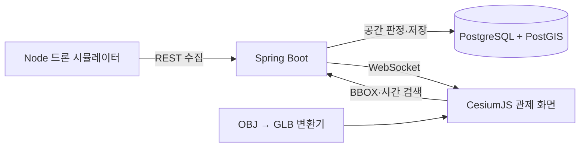

# GeoGuard 3D

CesiumJS, Spring Boot, PostGIS를 활용해 만든 **실시간 3D 드론 위험구역 관제 Web GIS** 개인 포트폴리오 프로젝트입니다.

드론 텔레메트리를 수집하여 PostGIS에 `PointZ`로 저장하고, 고도와 공간 연산으로 위험도를 판정합니다. 판정 결과는 WebSocket으로 CesiumJS 화면에 전송되며, 저장된 경로는 지도 영역(BBOX)과 시간 범위로 다시 검색할 수 있습니다.

## 핵심 구현 역량

| 역량 영역 | 구현 내용 |
|---|---|
| GIS 개발 | EPSG:4326, GeoJSON, BBOX, `ST_Covers`, `ST_DWithin` |
| 3D 모델 데이터 처리 | 자체 OBJ를 GLB로 변환하고 좌표·고도·방향에 맞춰 CesiumJS에 배치 |
| 공간정보 수집·저장·검색 | 실시간 수집, PostGIS PointZ, 10만 건 생성기, GiST 인덱스와 벤치마크 |
| 백엔드 서비스 | Spring Boot REST API, WebSocket, 검증·오류 응답, OpenAPI, 테스트 |

## 아키텍처



## 기술 스택

- Frontend: TypeScript, Vite, CesiumJS
- Backend: Java 21, Spring Boot, Gradle, JDBC, Flyway, OpenAPI
- Database: PostgreSQL, PostGIS, GiST 공간 인덱스
- Realtime: Raw WebSocket
- 3D: OBJ, glTF 2.0/GLB
- Infra: Docker Compose, Nginx

## 가장 빠른 실행

Docker가 설치된 환경에서:

```powershell
Copy-Item .env.example .env
docker compose up --build -d
```

`simulator` 컨테이너가 백엔드의 위험구역을 조회하고 모든 구역을 순회하는 `DRONE-LIVE-001` 위치를 1초마다 전송합니다. 브라우저에서 `http://localhost:5173`을 엽니다. API 문서는 `http://localhost:8080/swagger-ui.html`에서 확인할 수 있습니다.

## 개발 모드 실행

### 1. 데이터베이스

```powershell
Copy-Item .env.example .env
docker compose up -d --wait db
```

### 2. 백엔드

```powershell
$env:DB_URL='jdbc:postgresql://localhost:5432/geoguard'
$env:DB_USERNAME='geoguard'
$env:DB_PASSWORD='geoguard_local_only'
cd backend
.\gradlew.bat bootRun
```

### 3. 프런트엔드

```powershell
cd frontend
Copy-Item .env.example .env.local
npm install
npm run dev
```

백엔드가 연결되지 않아도 프런트엔드는 내장된 데모 궤적으로 작동합니다.

## 공개 데모와 Vercel 배포

루트의 `vercel.json`은 Vercel에서 `frontend`를 정적 빌드하며, `build:demo`가 공개 데모 모드를 활성화합니다. 이 모드에는 비밀키나 외부 데이터베이스 연결이 없으며 다음 기능을 브라우저의 합성 데이터로 체험할 수 있습니다.

- 두 위험구역을 순회하는 드론과 `SAFE` / `WARNING` / `DANGER` 전환
- `DEMO-HISTORY-01`의 최근 1시간 과거 경로 검색, 상태 필터, BBOX, 페이지 이동
- 실제 백엔드에서 사용할 시간 B-tree·위치 GiST 후보 인덱스 표시

화면의 `공개 데모`, `합성 데모`, `브라우저 데모` 표시는 실제 PostGIS 질의 결과와 혼동되지 않도록 합니다. 저장소를 Vercel에 가져오면 별도 환경변수 없이 배포할 수 있습니다.

```powershell
cd frontend
npm run build:demo
npm run preview
```

실제 Spring Boot/PostGIS 환경은 Vercel 정적 호스팅에 포함되지 않습니다. 실제 API를 공개 운영할 때는 백엔드와 PostgreSQL/PostGIS를 별도 서비스에 배포하고 `VITE_API_BASE_URL`, `VITE_WS_URL`, `VITE_DEMO_MODE=false`로 다시 빌드합니다.

### 공개 저장소 보안 범위

- 실제 `.env`와 `.env.local`, `.vercel`, 빌드 결과, 로컬 도구는 Git에서 제외합니다.
- 예제 비밀번호 `geoguard_local_only`는 로컬 개발 전용이며 운영 비밀번호로 사용하지 않습니다.
- Cesium Ion 토큰은 사용하지 않고 OpenStreetMap 공개 타일을 사용합니다.
- 포함된 위치·비행 이력·벤치마크 데이터는 모두 합성 데이터입니다.

### 4. 실시간 텔레메트리

별도 터미널에서:

```powershell
node scripts/simulate-drone.mjs
```

시뮬레이터는 `/api/zones`에서 현재 위험구역을 읽고 각 구역 내부를 순회합니다. 위치는 `POST /api/telemetry/batch`로 수집되어 PostGIS에 저장되고, 같은 데이터가 WebSocket `/ws/telemetry`를 통해 화면의 `DRONE-LIVE-001` 이동에 사용됩니다. 구역 사이를 이동할 때 `SAFE`, `WARNING`, `DANGER` 전환을 확인할 수 있습니다. 백엔드가 끊겼을 때만 브라우저의 `DRONE-01` 오프라인 데모가 대신 동작합니다.

### 5. 과거 경로 검색용 예시 데이터

백엔드 실행 중 아래 명령으로 최근 30분간 위험구역을 통과하는 `DEMO-HISTORY-01` 경로 181개를 저장할 수 있습니다.

```powershell
node scripts/seed-demo-history.mjs
```

화면에서 예시 ID와 최근 1시간을 선택하고 BBOX를 해제한 뒤 검색하면 노란색 과거 경로와 상태별 위치 수가 표시됩니다.

## 대량 데이터와 공간 인덱스 검증

```powershell
./scripts/load-test-data.ps1 -Count 100000
./scripts/run-benchmark.ps1
```

`generate_telemetry.sql`은 20대 드론의 위치를 기본 10만 건 생성합니다. 벤치마크는 같은 BBOX·시간 조건을 인덱스 미적용/적용 상태에서 각각 `EXPLAIN ANALYZE`로 실행합니다. 실제 실행 시간은 사용 환경에서 측정한 값만 포트폴리오에 기록해야 합니다.

2026-10-02 실제 PostGIS 측정 결과:

| 데이터 | 검색 결과 | 인덱스 전 | 인덱스 후 | 개선 |
|---:|---:|---:|---:|---:|
| 100,000건 | 10,645건 | 61.245ms | 9.485ms | 84.5% 감소(약 6.46배) |

인덱스 전에는 `Parallel Seq Scan`, 적용 후에는 시간 B-tree와 위치 GiST를 결합한 `BitmapAnd`가 사용됐습니다. 통합 테스트 3개와 상세 측정 환경은 [결과 문서](./infra/db/benchmark/results/2026-10-02-postgis-results.md)에 기록했습니다.

과거 경로 검색 화면도 같은 `/api/telemetry` 공간·시간 검색을 사용합니다. 현재 지도 BBOX는 기본 활성화되어 있고, 드론 ID·시간·상태 조건, 500건 단위 페이지 이동, 전체/현재 페이지 건수, 서버 검색 시간과 후보 인덱스를 확인할 수 있습니다. 실행 정보의 인덱스 목록은 조건상 사용 가능한 후보이며 실제 계획은 PostgreSQL 플래너가 통계와 선택도에 따라 결정합니다.

## 주요 API

```text
POST /api/telemetry/batch
GET  /api/telemetry?droneId=&bbox=&from=&to=&status=&page=&size=
GET  /api/drones/{id}/track?from=&to=
GET  /api/zones
GET  /api/events?status=&droneId=&from=&to=
POST /api/routes/analyze
WS   /ws/telemetry
```

## 3D 모델 파이프라인

모델은 외부 라이선스에 의존하지 않도록 저장소에서 직접 제작했습니다.

```powershell
node assets/build-drone-model.mjs
```

- 입력: `assets/raw/geoguard-drone.obj`
- 출력: `assets/processed/geoguard-drone.glb`
- 처리: 면 삼각분할, 정점 법선 계산, 4바이트 정렬, glTF 2.0 바이너리 패키징
- 현재 결과: 42 vertices, 32 triangles, 2,172 bytes

## 테스트와 빌드

```powershell
cd frontend
npm run build

cd ..
node --test scripts/patrol-route.test.mjs

cd backend
.\gradlew.bat test
```

Docker가 있으면 Testcontainers 기반 PostGIS 통합 테스트도 실행됩니다. Docker가 없으면 공간 API 통합 테스트는 자동으로 건너뛰고 단위 테스트를 실행합니다.

Docker를 사용할 수 없는 환경에서는 `GEOGUARD_TEST_DB_URL`을 지정해 `ExternalPostgisIntegrationTest`의 동일한 공간 시나리오 3개를 실제 PostGIS에 실행할 수 있습니다.

## 프로젝트 구조

```text
frontend/      CesiumJS 관제 화면과 Nginx 설정
backend/       Spring Boot REST·WebSocket·공간 질의
infra/db/      PostGIS 스키마, 시드, 대량 데이터, 벤치마크
assets/        자체 OBJ, 변환기, 생성된 GLB
scripts/       시뮬레이터와 데이터 적재·측정 도구
```

상세한 하루 작업 계획과 용어 설명은 [PORTFOLIO_PROJECT_PLAN.md](./PORTFOLIO_PROJECT_PLAN.md)에 있습니다.

## 현재 제한과 다음 단계

- 합성 위험구역과 합성 드론 데이터만 사용합니다.
- GeoServer, RabbitMQ, 3D Tiles 변환은 하루 범위에서 제외했습니다.
- 다음 단계는 실측 데이터, 다수 드론 부하 시험, CZML 경로 재생, GeoServer WMS/WMTS 연동입니다.
